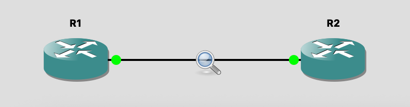
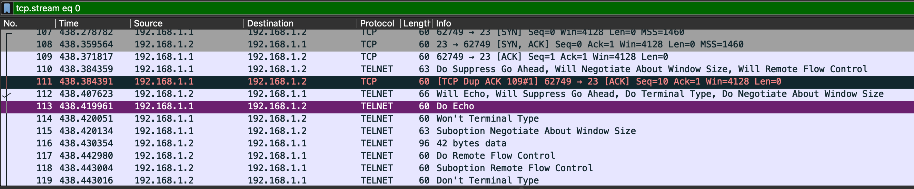
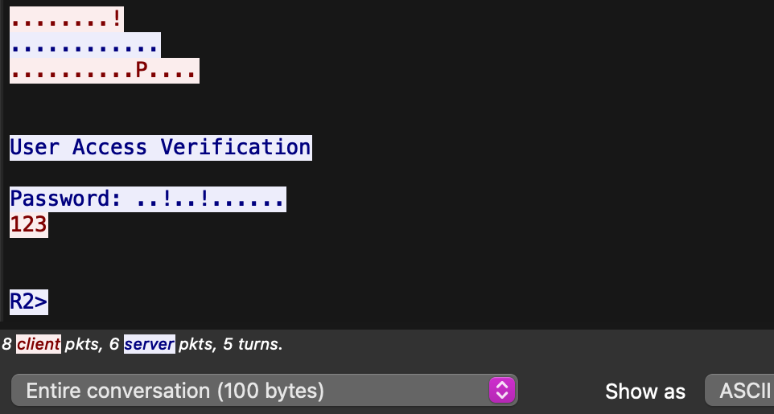
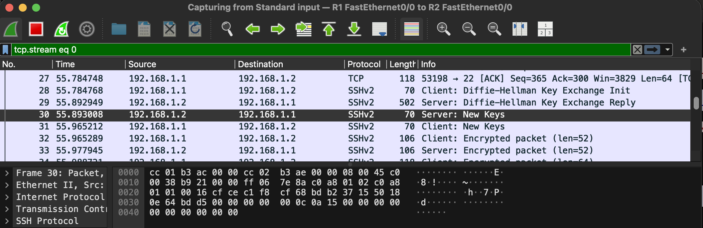
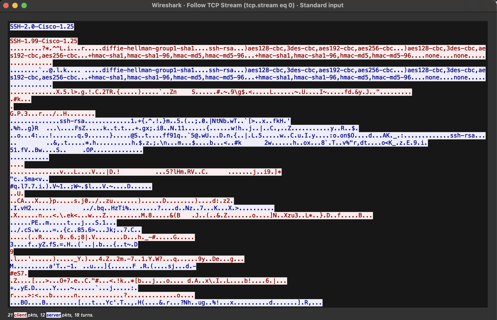

# Lab 1: Telnet vs SSH (GNS3 + Wireshark)

Module: Cryptography and Security Fundamentals, MEng Cyber Security, University of Limerick

## Summary

I built a two-router network in GNS3, configured the same remote access twice (first Telnet, then SSH), and captured each login in Wireshark. Telnet exposed the password in clear text. SSH exchanged keys and then sent only encrypted packets, so the credentials were unreadable.

| | Telnet | SSH |
|---|---|---|
| TCP port | 23 | 22 |
| Password visible in capture | Yes, `123` in plain text | No |
| Session data | Plain text | Encrypted |
| Stream size for one login | 100 bytes, 14 packets | 2099 bytes, 33 packets |

## Objectives

- Build a two-subnet style lab in GNS3 using Cisco routers.
- Configure Telnet and SSH access on a router and compare them.
- Capture traffic with Wireshark and inspect it with Follow TCP Stream.
- Explain why SSH is secure and Telnet is not.

## Environment

- GNS3 2.2.61 on macOS (Dynamips, Cisco c3600 IOS image)
- Wireshark (launched from GNS3 by right-clicking the link > Start capture)
- IOS with crypto support (`show ip ssh` reports SSH enabled, version 2.0)

## Topology



| Device | Interface | IP address |
|---|---|---|
| R1 (client) | FastEthernet0/0 | 192.168.1.1/24 |
| R2 (server) | FastEthernet0/0 | 192.168.1.2/24 |

Both routers share one subnet over a single link. The capture runs on that link.

## Configuration

### Interfaces

```
! R1
enable
conf t
hostname R1
interface fa0/0
 ip address 192.168.1.1 255.255.255.0
 no shutdown
end

! R2
enable
conf t
hostname R2
interface fa0/0
 ip address 192.168.1.2 255.255.255.0
 no shutdown
end
```

Connectivity check from R1: `ping 192.168.1.2`

### Part 1: Telnet on R2

```
conf t
username admin password 123
line vty 0 4
 password 123
 login
 transport input telnet
end
```

### Part 2: SSH on R2

```
conf t
ip domain-name lab.local
crypto key generate rsa      ! modulus: 1024 (per handout)
ip ssh version 2
username admin password 123
line vty 0 4
 transport input ssh
 login local
end
```

Check:

```
R2# show ip ssh
SSH Enabled - version 2.0
Authentication timeout: 120 secs; Authentication retries: 3
```

## Part 1: Telnet capture

Command on R1: `telnet 192.168.1.2`, then enter the vty password.

Wireshark showed the TCP handshake to port 23, then Telnet option negotiation (Will Echo, Do Suppress Go Ahead, Window Size, Flow Control), then the login prompt.



Follow TCP Stream shows the whole conversation in readable text, including the password the client typed:



What this shows:

- The "User Access Verification" banner and the `Password:` prompt are readable.
- The password `123` appears in the client's half of the stream (red).
- The session ends at the `R2>` prompt, so anyone on the link also sees that the login worked.
- The full login was 100 bytes across 8 client and 6 server packets.

## Part 2: SSH capture

Command on R1: `ssh -l admin 192.168.1.2`

After the TCP handshake on port 22, the two routers exchanged version banners, then did a Diffie-Hellman key exchange. Once both sides sent "New Keys", every packet was "Encrypted packet".



Follow TCP Stream shows the version banners and the algorithm lists in clear text, then unreadable binary:



What this shows:

- Only the setup is readable: the banners (`SSH-2.0-Cisco-1.25`, `SSH-1.99-Cisco-1.25`) and the lists of algorithms each side supports. None of this is secret.
- The username and password are inside the encrypted part, so they never appear in the capture.
- The login was 2099 bytes across 21 client and 12 server packets, mostly key exchange overhead.

## Comparison

| Area | Telnet | SSH |
|---|---|---|
| Confidentiality | None | Encrypted session |
| Credentials on the wire | Clear text | Protected after key exchange |
| Server authentication | None, so no protection against impersonation | Host key (RSA) |
| Integrity | None | MAC on each packet |
| Verdict | Do not use on real networks | Standard for device management |

Analogy: Telnet is a postcard, so anyone handling it can read it. SSH is a locked envelope, and the key is agreed privately before anything sensitive is sent.

## Security observations

1. **Telnet should not be enabled anywhere that matters.** Anyone who can capture traffic on the path (a compromised switch, a mirrored port, a rogue device on the LAN) gets working credentials.
2. **The SSH here is better than Telnet but uses dated algorithms.** The algorithm lists in the capture offer only `diffie-hellman-group1-sha1`, `ssh-rsa`, CBC ciphers (`aes128-cbc`, `3des-cbc`, `aes192-cbc`, `aes256-cbc`) and `hmac-sha1` / `hmac-md5` variants. That is typical of old IOS images. A production device should use a stronger key exchange, CTR or GCM ciphers, 2048-bit or larger RSA keys, and SHA-2 MACs where supported.
3. **Encryption does not hide everything.** Source and destination IPs, ports, packet sizes and timing are still visible to an observer.
4. **The lab credentials are weak by design.** `admin` / `123` with `username ... password` stores the password weakly. A real setup would use `username ... secret`, strong passwords or key-based login, and an access list on the vty lines.
5. **Restrict the management plane.** Use `transport input ssh`, `ip ssh version 2`, vty access classes and a login timeout.

## Handout corrections and issues

- The handout types `password`, `login` and `transport input` in global config. They only work after `line vty 0 4`.
- RSA key generation needs a hostname and a domain name set first. The handout skips the hostname.
- The handout builds R3 and R4 for the SSH half. The same R1 and R2 pair works, because `transport input ssh` replaces Telnet on R2. Do the Telnet capture before switching R2 to SSH.
- GNS3 could not start Wireshark at first because it was not installed in `/Applications`. Installing Wireshark and the ChmodBPF package fixed it.

## Reproduce it

1. Create two c3600 routers in GNS3 and connect FastEthernet0/0 to FastEthernet0/0.
2. Apply the interface and Telnet config, then ping to confirm connectivity.
3. Right-click the link > Start capture. In Wireshark, filter `telnet`.
4. From R1 run `telnet 192.168.1.2`, log in, then Follow > TCP Stream.
5. Apply the SSH config on R2 and start a new capture with filter `ssh`.
6. From R1 run `ssh -l admin 192.168.1.2`, log in, then Follow > TCP Stream.

## What I learned

- How a protocol looks on the wire, and why "it works" is not the same as "it is safe".
- How to use Wireshark's capture filters and Follow TCP Stream to prove a claim with evidence.
- That the SSH setup phase is visible, and that algorithm choices matter as much as having encryption at all.
