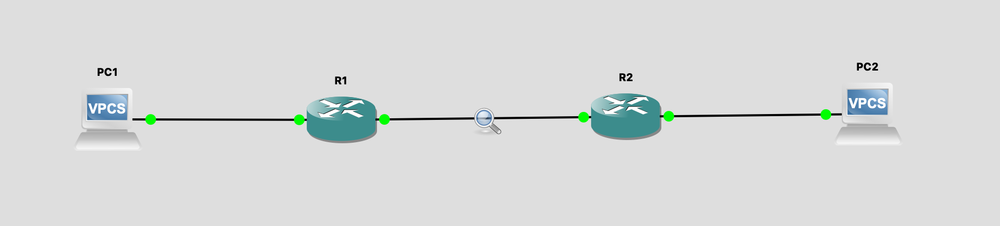
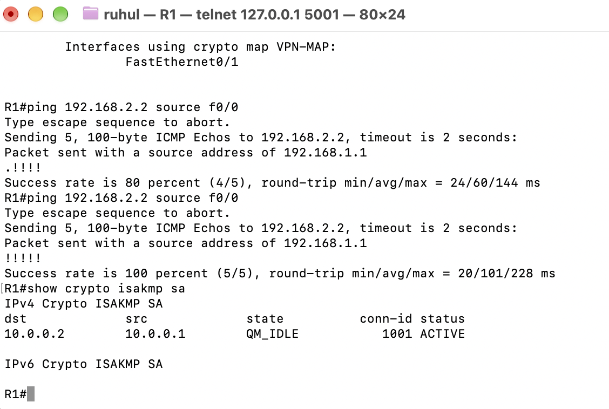
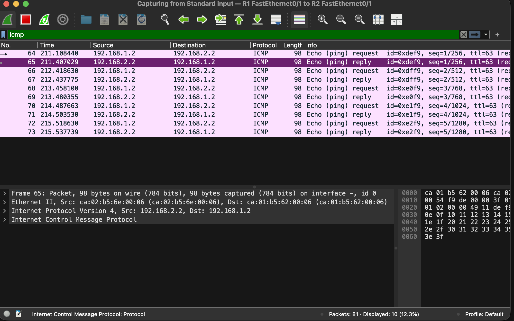
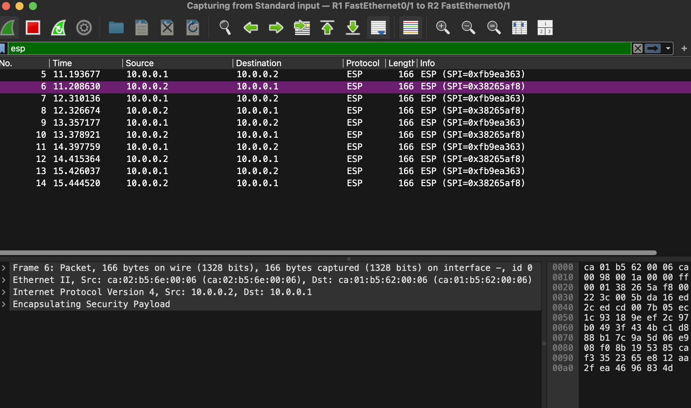

# Lab 2: IPSec Site-to-Site VPN (GNS3 + Wireshark)

Module: Cryptography and Security Fundamentals, MEng Cyber Security, University of Limerick

## Summary

I built two LANs joined by a routed WAN link in GNS3 and confirmed PC1 could ping PC2. I captured that ping on the WAN link and it was readable in clear text. Then I configured an IPSec site-to-site VPN between R1 and R2 (IKE Phase 1, Phase 2, crypto ACL and crypto map) and captured the same ping again. This time the WAN link only carried ESP between the two routers. The PC addresses and the ping contents were gone.

| | Before VPN | After VPN |
|---|---|---|
| Protocol on the WAN link | ICMP | ESP (IKE on UDP 500 during setup) |
| Addresses visible | 192.168.1.2 and 192.168.2.2 | 10.0.0.1 and 10.0.0.2 only |
| Payload readable | Yes | No |
| Frame size for one ping | 98 bytes | 166 bytes |

## Objectives

- Configure a site-to-site IPSec VPN between two routers.
- Generate traffic between the two LANs.
- Capture the WAN link in Wireshark with and without IPSec and compare.
- Verify the tunnel with the IOS `show crypto` commands.

## Environment

- GNS3 2.2.61 on macOS (Dynamips), VPCS for the two PCs
- Cisco 7200 router (NPE-400), IOS 15.2(4)S5 advanced IP services image
- Wireshark 4.6.9, started from GNS3 by right-clicking the link and choosing Start capture

## Topology



| Device | Interface | IP address | Gateway |
|---|---|---|---|
| R1 | FastEthernet0/0 | 192.168.1.1/24 | |
| R1 | FastEthernet0/1 | 10.0.0.1/30 | |
| R2 | FastEthernet0/0 | 192.168.2.1/24 | |
| R2 | FastEthernet0/1 | 10.0.0.2/30 | |
| PC1 | NIC | 192.168.1.2/24 | 192.168.1.1 |
| PC2 | NIC | 192.168.2.2/24 | 192.168.2.1 |

The WAN link is the 10.0.0.0/30 network between R1 f0/1 and R2 f0/1. The captures run on that link.

## Configuration

### Step 1: Interfaces and static routes

```
PC1> ip 192.168.1.2/24 192.168.1.1
PC2> ip 192.168.2.2/24 192.168.2.1

! R1
conf t
interface f0/0
 ip address 192.168.1.1 255.255.255.0
 no shutdown
interface f0/1
 ip address 10.0.0.1 255.255.255.252
 no shutdown
exit
ip route 192.168.2.0 255.255.255.0 10.0.0.2
end

! R2
conf t
interface f0/0
 ip address 192.168.2.1 255.255.255.0
 no shutdown
interface f0/1
 ip address 10.0.0.2 255.255.255.252
 no shutdown
exit
ip route 192.168.1.0 255.255.255.0 10.0.0.1
end
```

Check: `ping 192.168.2.2` from PC1. Capture this first, before any VPN config.

### Step 2: IPSec VPN

R1:

```
conf t
crypto isakmp policy 10
 encr aes
 hash sha256
 authentication pre-share
 group 2
 lifetime 86400
exit
crypto isakmp key VPN123 address 10.0.0.2
crypto ipsec transform-set MYSET esp-aes esp-sha-hmac
 mode tunnel
exit
ip access-list extended VPN-TRAFFIC
 permit ip 192.168.1.0 0.0.0.255 192.168.2.0 0.0.0.255
exit
crypto map VPN-MAP 10 ipsec-isakmp
 set peer 10.0.0.2
 set transform-set MYSET
 match address VPN-TRAFFIC
exit
interface f0/1
 crypto map VPN-MAP
end
```

R2 is the mirror image. The peer is 10.0.0.1, the key line uses address 10.0.0.1, and the ACL has source and destination swapped:

```
ip access-list extended VPN-TRAFFIC
 permit ip 192.168.2.0 0.0.0.255 192.168.1.0 0.0.0.255
```

The key `VPN123` is a lab value only.

What each part does:

- **ISAKMP policy (Phase 1):** the two routers agree on how to protect their own negotiation (AES, SHA-256, pre-shared key, Diffie-Hellman group 2) and build a secure channel.
- **Transform set (Phase 2):** how the actual traffic is protected, here ESP with AES encryption and an HMAC-SHA integrity check, in tunnel mode.
- **Crypto ACL:** defines the "interesting traffic". Only packets from 192.168.1.0/24 to 192.168.2.0/24 (and the reverse on R2) go into the tunnel.
- **Crypto map:** binds the peer, transform set and ACL together and is applied to the WAN interface.

## Verification

Pinging from R1 with the LAN as the source address matches the crypto ACL and starts the tunnel:

```
R1# ping 192.168.2.2 source f0/0
```

The first packet is usually lost while IKE negotiates, then the rest succeed.



`show crypto isakmp sa` shows state `QM_IDLE` and status `ACTIVE`, so Phase 1 is up. `show crypto ipsec sa` (excerpt) shows Phase 2 working in both directions:

```
R1# show crypto ipsec sa
interface: FastEthernet0/1
    Crypto map tag: VPN-MAP, local addr 10.0.0.1
   local  ident (addr/mask/prot/port): (192.168.1.0/255.255.255.0/0/0)
   remote ident (addr/mask/prot/port): (192.168.2.0/255.255.255.0/0/0)
   current_peer 10.0.0.2 port 500
    #pkts encaps: 18, #pkts encrypt: 18, #pkts digest: 18
    #pkts decaps: 18, #pkts decrypt: 18, #pkts verify: 18
    #send errors 0, #recv errors 0
     current outbound spi: 0x71F7A273(1912054387)
     inbound esp sas:
      spi: 0x32A8AD00(849915136)
```

Equal encaps and decaps with zero errors means traffic is being encrypted going out and decrypted coming back. `show crypto map` also confirms `VPN-MAP` is bound to FastEthernet0/1 with peer 10.0.0.2, transform set `MYSET` and ACL `VPN-TRAFFIC`.

## Wireshark: before the VPN

Filter `icmp` on the R1 to R2 link. Every echo request and reply is readable, with the real PC addresses.



What this shows:

- Source 192.168.1.2 and destination 192.168.2.2 are visible on the WAN link. Anyone who can tap the link knows which hosts are talking.
- The ICMP data is in the clear (the hex pane shows the ping pattern).
- Each frame is 98 bytes.

## Wireshark: after the VPN

Filter `esp`. The ICMP is gone and only ESP between the routers remains.



What this shows:

- The only addresses are 10.0.0.1 and 10.0.0.2. The original IP header with the PC addresses is inside the encrypted payload.
- The payload is unreadable. Wireshark cannot decode it without the keys.
- There are two different SPI values, one for each direction (`0xfb9ea363` from R1 to R2 and `0x38265af8` from R2 to R1). An IPSec tunnel is a pair of one-way security associations.
- Each frame is now 166 bytes. The extra bytes are the new outer IP header, the ESP header, padding and the integrity check value.

The SPIs in the `show crypto ipsec sa` excerpt above are different from the ones in this capture. The tunnel was cleared and rebuilt between the two, and every new tunnel gets new SPIs. Within one session the SPIs in the router output match the ones in the capture.

## Comparison

| Area | Without IPSec | With IPSec (ESP, tunnel mode) |
|---|---|---|
| Confidentiality | None, payload readable | AES encryption |
| Host addresses visible on the WAN | Yes | No, only router addresses |
| Integrity | None | HMAC-SHA on each packet |
| Peer authentication | None | Pre-shared key in IKE |
| Verdict | Fine inside a trusted LAN, not across an untrusted network | Suitable for linking sites over the internet |

Analogy: without IPSec each ping is a postcard. With IPSec the router puts the whole postcard inside a sealed envelope and addresses the envelope to the other router.

## Security observations

1. **The pre-shared key is a weak point.** A static shared string is simple, but anyone who learns it can impersonate a peer. Certificates or a long random key are better.
2. **Phase 1 and Phase 2 use different strengths.** Phase 1 uses SHA-256, but the transform set uses `esp-sha-hmac`, which is HMAC-SHA-1. The strongest link sets the tone only if the others match it.
3. **Diffie-Hellman group 2 is dated.** It is a 1024-bit group. Group 14 or higher (or an elliptic curve group) is recommended.
4. **No perfect forward secrecy.** The output shows `PFS (Y/N): N`. Without PFS, if the Phase 1 key is ever compromised, traffic protected under it can be exposed. Adding `set pfs group14` to the crypto map fixes that.
5. **Encryption does not hide everything.** The outer IPs, packet sizes and timing are still visible on the WAN. The link between the PCs and their routers is not protected at all.
6. **The VPN protects the path, not the endpoints.** Traffic is encrypted only between R1 and R2. It still travels in clear text on each LAN.
7. **Only the interesting traffic is protected.** The crypto ACL decides what is encrypted. A wrong or missing ACL silently leaves traffic unprotected or stops the tunnel forming.

## Issues I hit and how I fixed them

- **Routers crashed on start.** GNS3 reported "Dynamips hypervisor process has stopped, return code: -8". The cause was that my c7200 template pointed at a c3660 IOS image. Pointing it at a proper c7200 image fixed it. The first save afterwards also asked to overwrite an NVRAM config written by a different image version.
- **Configs disappeared after restarting the devices.** A stopped router boots with a blank config, and VPCS loses its IP. `write memory` on the routers and `save` on the PCs fixes it. I now save at the end of every step.
- **The tunnel would not come up.** The log showed `%CRYPTO-6-IKMP_MODE_FAILURE: Processing of Informational mode failed with peer`. Comparing `show run | section crypto` on both routers showed two faults. R2 was missing the `hash sha256` line, so it defaulted to SHA-1 while R1 asked for SHA-256. And the crypto ACL on R2 was empty, because R2's ACL line had been pasted into R1 by mistake. Fixing both and running `clear crypto isakmp` and `clear crypto sa` brought the tunnel up (`QM_IDLE`).
- **Handout copy and paste.** The handout includes the router prompts and some stray prompt lines. Pasting them whole can put a command in the wrong mode or the wrong router. I pasted commands only, one block at a time, and checked the window title first.
- **First ping lost.** Normal. The tunnel is built when the first interesting packet arrives.

## Reproduce it

1. Create two Cisco 7200 routers and two VPCS in GNS3. Connect PC1 to R1 f0/0, R1 f0/1 to R2 f0/1, and R2 f0/0 to PC2.
2. Apply the interface and static route config, then ping PC1 to PC2.
3. Right-click the R1 to R2 link, start a capture, filter `icmp`, and ping again. Save a screenshot.
4. Apply the IPSec config on both routers. Check that the ACLs are mirror images.
5. Run `ping 192.168.2.2 source f0/0` on R1, then `show crypto isakmp sa` and `show crypto ipsec sa`.
6. Capture again with filter `isakmp || esp` and ping. Save a screenshot.
7. Run `write memory` on both routers and `save` on both PCs.

## What I learned

- Why IPSec needs two phases, and what each configuration block (policy, transform set, ACL, crypto map) is responsible for.
- How to prove encryption with evidence: the same traffic shown readable and then unreadable on the same link.
- That one missing line on one router can stop a tunnel, and that `show run | section crypto` on both ends is the quickest way to find a mismatch.
- That "encrypted" is not the same as "fully hidden". The outer addresses, sizes and timing still leak.
