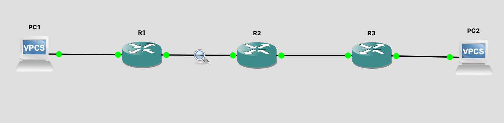
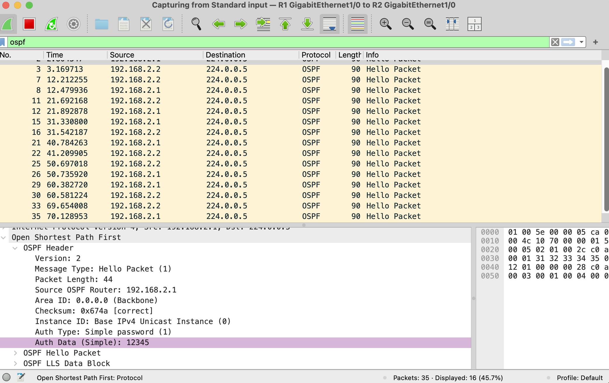
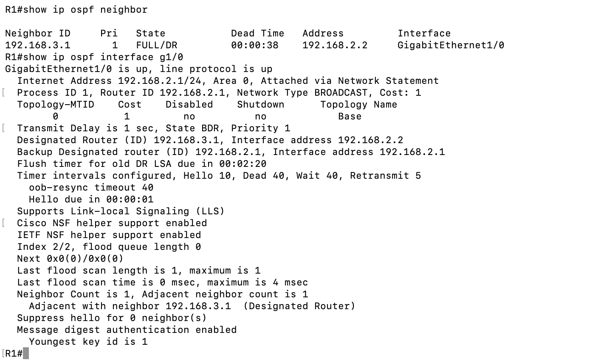
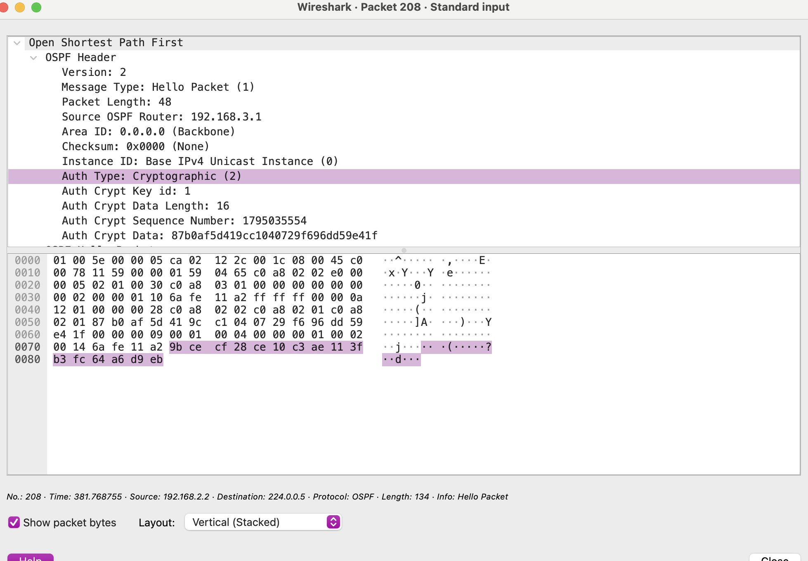

# Lab 6: Securing OSPF with Plain-Text and MD5 Authentication (GNS3 + Wireshark)

Module: Cryptography and Security Fundamentals, MEng Cyber Security, University of Limerick

## Summary

I built a three router OSPF network in GNS3, then added authentication to the router links in two stages. First I used plain-text authentication and captured the OSPF Hello packets on the R1 to R2 link. The password was visible in the packet. Then I switched the same links to MD5 authentication and captured again. This time the packet carried a key ID, a sequence number and a 16 byte digest, and the key itself was nowhere in the capture.

| | Plain-text auth | MD5 auth |
|---|---|---|
| Auth Type in the OSPF header | Simple password (1) | Cryptographic (2) |
| Key visible in the capture | Yes, `12345` | No |
| What is sent | The password itself | Key ID, sequence number and a 16 byte digest |
| Replay protection | None | Sequence number |
| Integrity check | None | Digest covers the whole OSPF packet |

## Objectives

- Configure OSPF across three routers in one area.
- Add plain-text authentication and then MD5 authentication on the router links.
- Verify neighbours and authentication with IOS show commands.
- Capture OSPF in Wireshark and compare the authentication fields.

## Environment

- GNS3 2.2.61 on macOS (Dynamips), VPCS for the two PCs
- Cisco 7200 routers (NPE-400), IOS 15.2(4)S5, with a FastEthernet module in slot 0 and PA-GE gigabit modules in the slots used for g1/0 and g2/0
- Wireshark, started from GNS3 on the R1 to R2 link with the display filter `ospf`

## Topology



| Device | Interface | IP address | Connected to |
|---|---|---|---|
| R1 | f0/0 | 192.168.1.1/24 | PC1 |
| R1 | g1/0 | 192.168.2.1/24 | R2 g1/0 |
| R2 | g1/0 | 192.168.2.2/24 | R1 g1/0 |
| R2 | g2/0 | 192.168.3.1/24 | R3 g2/0 |
| R3 | g2/0 | 192.168.3.2/24 | R2 g2/0 |
| R3 | f0/0 | 192.168.4.1/24 | PC2 |
| PC1 | NIC | 192.168.1.2/24, gateway 192.168.1.1 | R1 |
| PC2 | NIC | 192.168.4.2/24, gateway 192.168.4.1 | R3 |

All router interfaces are in OSPF process 1, area 0.

## Configuration

### Step 1: Addressing

```
R1
conf t
hostname R1
interface f0/0
 ip address 192.168.1.1 255.255.255.0
 no shutdown
interface g1/0
 ip address 192.168.2.1 255.255.255.0
 no shutdown
end

R2
conf t
hostname R2
interface g1/0
 ip address 192.168.2.2 255.255.255.0
 no shutdown
interface g2/0
 ip address 192.168.3.1 255.255.255.0
 no shutdown
end

R3
conf t
hostname R3
interface g2/0
 ip address 192.168.3.2 255.255.255.0
 no shutdown
interface f0/0
 ip address 192.168.4.1 255.255.255.0
 no shutdown
end

PC1> ip 192.168.1.2/24 192.168.1.1
PC2> ip 192.168.4.2/24 192.168.4.1
```

### Step 2: OSPF

```
R1
router ospf 1
 network 192.168.1.0 0.0.0.255 area 0
 network 192.168.2.0 0.0.0.255 area 0

R2
router ospf 1
 network 192.168.2.0 0.0.0.255 area 0
 network 192.168.3.0 0.0.0.255 area 0

R3
router ospf 1
 network 192.168.3.0 0.0.0.255 area 0
 network 192.168.4.0 0.0.0.255 area 0
```

`show ip ospf neighbor` should show state FULL on every router before moving on.

### Step 3: Plain-text authentication

I started the Wireshark capture on the R1 to R2 link first, then applied this on R1 g1/0, R2 g1/0, R2 g2/0 and R3 g2/0:

```
interface g1/0          ! g2/0 where that is the link
 ip ospf authentication
 ip ospf authentication-key 12345
```

### Step 4: MD5 authentication

Same four interfaces:

```
interface g1/0          ! g2/0 where that is the link
 ip ospf message-digest-key 1 md5 MySecretKey
 ip ospf authentication message-digest
```

Both ends of a link need the same key ID and key. Until both sides match, the neighbour drops. The key ID is a label, so it has to match too.

## Wireshark: plain-text authentication

Filter `ospf` on the R1 to R2 link.



What this shows:

- The Hellos go to the multicast address 224.0.0.5 every 10 seconds, from both 192.168.2.1 and 192.168.2.2.
- In the OSPF header, `Auth Type: Simple password (1)` and `Auth Data (Simple): 12345`. The password is sent in the clear in every packet.
- Anyone who can capture on the link can read it and then form an adjacency with the same key.

## Verification with MD5



On R1:

- `show ip ospf neighbor` shows neighbour 192.168.3.1 (R2's router ID) in state FULL/DR on GigabitEthernet1/0.
- `show ip ospf interface g1/0` shows `Message digest authentication enabled` and `Youngest key id is 1`.
- The same output shows R1 as the backup designated router, Hello 10 and Dead 40.

## Wireshark: MD5 authentication



What this shows:

- `Auth Type: Cryptographic (2)`, with `Auth Crypt Key id: 1` and `Auth Crypt Data Length: 16`.
- A cryptographic sequence number (1795035554 in this packet). It increases with each packet, which stops an attacker replaying an old Hello.
- `Auth Crypt Data` is a 16 byte digest, `87b0af5d419cc1040729f696dd59e41f` in this packet. The router computes it from the packet and the shared key, and the receiver recomputes it to check.
- The OSPF checksum field is `0x0000 (None)`, because the digest does the integrity job instead.
- The string `MySecretKey` does not appear anywhere in the packet or the hex dump.

## Comparison

| Area | Plain-text | MD5 |
|---|---|---|
| Password on the wire | Yes | No, only a digest |
| Detects tampering | No | Yes, the digest changes if the packet changes |
| Detects replay | No | Yes, through the sequence number |
| Proves the sender knows the key | Only by sending the key itself | Yes, without revealing it |
| Encrypts the routing data | No | No |

Analogy: plain-text authentication is shouting the password at the door every 10 seconds. MD5 is showing a stamp that can only be made with the password. A watcher sees the stamp, but cannot work out the password from it.

## Security observations

1. **Plain-text authentication is not really security.** It stops an accidental neighbour, but the password is in every Hello, so one capture gives it away.
2. **MD5 authenticates, it does not encrypt.** The OSPF packets, and so the network topology and routes, are still readable on the wire.
3. **MD5 is an old hash.** Practical collision attacks exist for it. OSPF uses a keyed MD5 digest, which is stronger than plain MD5, but newer options are better. IOS supports HMAC-SHA authentication for OSPFv2 with key chains, and OSPFv3 can use IPsec.
4. **One shared key.** Every router on the segment uses the same key, so one compromised router exposes the key for the whole link, and changing it means touching every router.
5. **Keys sit in the configuration.** `show run` shows the key unless `service password-encryption` is on, and even then it is only weakly obscured. A leaked config leaks the key.
6. **Authentication is per interface.** I enabled it on the router to router links. A link left without it would still accept unauthenticated neighbours, and the PC LANs only stay safe if they are not in OSPF or are made passive.
7. **A weak key weakens everything.** `MySecretKey` and `12345` are lab values. A short or guessable key can be brute forced offline from a capture.

## Handout problems I worked around

- **The IP table and the configuration steps disagree.** The table lists addresses such as 192.168.12.2, 192.168.23.x and 192.168.3.3, but the configuration steps use 192.168.2.x, 192.168.3.x and 192.168.4.x. I followed the configuration steps, since those are the commands that actually produce a working network.
- **The test ping points at 192.168.3.10.** No device has that address. PC2 is on 192.168.4.0/24, so the target is 192.168.4.2.
- **Authentication commands appear at the `(config-router)#` prompt.** They are interface commands, so they have to be typed at `(config-if)#`.
- **Gigabit interfaces need the right module.** The 7200 only has g1/0 and g2/0 if a PA-GE module is in slot 1 or 2, so the slots have to be set in GNS3 before the routers start. Wrong slots crash the node or leave the interface missing.
- **Save your work.** A router restarts with a blank config unless I run `write memory`, and VPCS needs `save`.

## Reproduce it

1. Create three Cisco 7200 routers and two VPCS in GNS3. Add PA-GE modules for g1/0 and g2/0.
2. Link PC1 to R1 f0/0, R1 g1/0 to R2 g1/0, R2 g2/0 to R3 g2/0 and R3 f0/0 to PC2.
3. Apply the addressing and OSPF configuration, then check `show ip ospf neighbor` for FULL.
4. Start a capture on the R1 to R2 link with filter `ospf`.
5. Apply plain-text authentication on all four router interfaces. Screenshot a Hello.
6. Apply MD5 authentication on the same interfaces. Screenshot a new Hello.
7. Run `show ip ospf neighbor` and `show ip ospf interface g1/0`, then `write memory` on all routers.

## What I learned

- How OSPF neighbours find each other and why an unauthenticated routing protocol is easy to abuse.
- That plain-text authentication shows the password in every packet, and MD5 replaces it with a keyed digest, a key ID and a sequence number.
- Where to find these fields in Wireshark, and how to prove the difference with screenshots of the same link.
- That authentication and encryption are different things. MD5 here protects who is talking and that the packet is unchanged, but not what it says.
